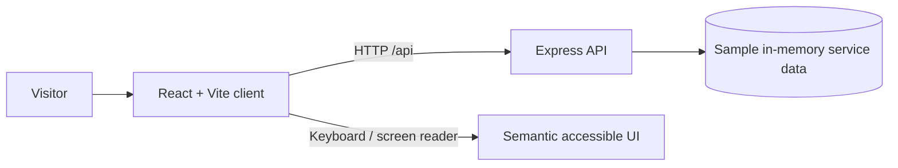

# Architecture

## System context

## Boundaries

- `client/`: presentation, client-side filtering, accessible components and API calls.
- `server/`: HTTP routes, validation and business logic. The current starter uses a small in-memory sample dataset.
- `docs/`: audit evidence, decisions and setup documentation.
- `tests/`: browser-level user journeys. Unit tests live beside the code they cover.

## First vertical slice: service directory

The visitor opens the directory, enters a search term in a labelled search field, and sees matching sample service entries. The client calls `GET /api/services`; the API returns JSON. The interface uses a real heading hierarchy, a skip link, a visible focus indicator, a live status message and semantic lists.

## Local setup

See the root README. Use Node.js 20.19+ or 22.12+ and npm 10+. `npm install`, then `npm run dev`.

## Known architectural unknowns about India.gov.in

A browser-visible public page does not establish the site's private source-code structure, backend framework, database, hosting provider, CMS configuration, deployment topology or internal API contracts. This project does not claim to reverse-engineer those private systems. Its architecture is a proposed independent implementation foundation.
